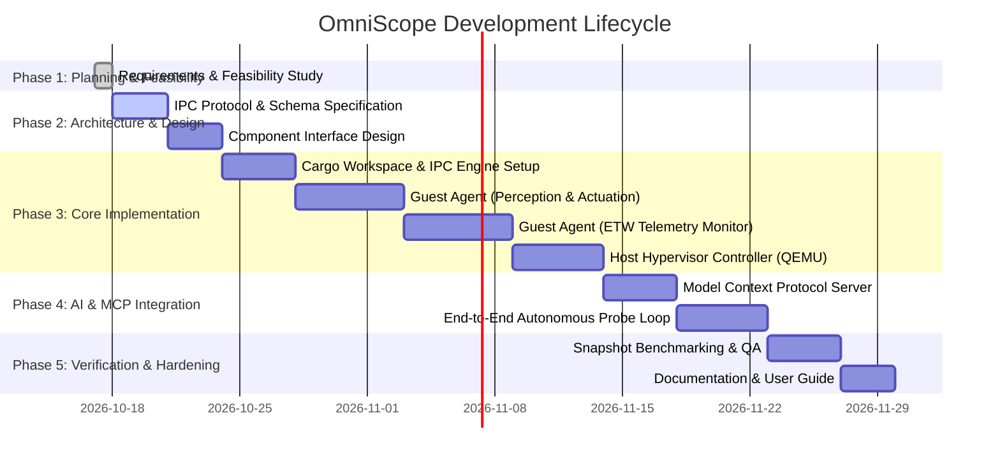

# SDLC Phase 1: Project Charter, Planning & Feasibility Study

**Project Name:** OmniScope (AI-Orchestrated Dynamic Software Introspection & Interaction Sandbox)  
**Target Platform:** Windows Host & Guest (with modular design for Linux/KVM targets)  
**Primary Language:** Rust (`stable-x86_64-pc-windows-msvc`)  
**Document Version:** 1.0.0  
**Status:** Under Review (SDLC Phase 1)

---

## 1. Executive Summary & Vision

### 1.1 Problem Statement
Modern software reverse engineering, dynamic analysis, and software comprehension require an analyst to manually coordinate multiple isolated tools:
1. Virtualization software (VMware, VirtualBox, QEMU) to safely isolate untrusted binaries.
2. System monitoring utilities (Process Monitor, Wireshark, ETW) to observe file, registry, and network activity.
3. Dynamic binary instrumentation frameworks (Frida, x64dbg) to hook runtime routines.
4. Manual GUI interaction (mouse/keyboard input) to trigger specific application code paths.

While modern Large Language Models (LLMs) and Multimodal AI agents excel at reasoning about code and executing structured tool calls, there is no unified, high-performance sandbox runtime that simultaneously gives an AI agent:
- **Physical/UI agency:** Zero-latency visual perception and synthetic user interaction.
- **Deep system observability:** Streamed system-level telemetry (syscalls, file I/O, IPC, network requests, loaded modules).
- **Temporal control:** Copy-on-write (CoW) memory snapshots and deterministic state rollback.

### 1.2 Project Objective
Build **OmniScope**, a high-performance sandbox written in Rust, engineered specifically to expose an isolated operating system environment to an AI agent. The AI agent will be able to run any target software, observe internal and external execution dynamics, physically manipulate the GUI like an end user, and incrementally build a comprehensive architectural and behavioral model of the application.

---

## 2. Requirements Specification

### 2.1 Functional Requirements (FR)

| ID | Category | Requirement Description |
| :--- | :--- | :--- |
| **FR-01** | **Isolation & Containment** | Execute target software inside an isolated hardware-virtualized guest with strict host air-gapping and immutable base disk. |
| **FR-02** | **Snapshotting** | Support fast VM/guest checkpointing and rollback (RAM + disposable CoW overlay) to allow exploratory AI interaction with instant recovery. |
| **FR-03** | **Visual Perception** | Capture guest desktop frame buffers at high frequency (>30 FPS) with delta encoding to feed multimodal AI vision models. |
| **FR-04** | **Input Emulation** | Provide programmatic control over synthetic keyboard and mouse events using human-like Bézier curves and natural timing to prevent anti-automation detection. |
| **FR-05** | **Semantic UI Tree** | Query and stream the OS Accessibility Tree (Windows UI Automation) to give the AI structured semantic understanding of visible windows, controls, and elements. |
| **FR-06** | **Process Observability** | Trace process creation, module loads/unloads, thread activity, and handles in real time. |
| **FR-07** | **System Telemetry** | Intercept and log file system I/O, registry modifications, and inter-process communication (IPC). |
| **FR-08** | **Network Auditing & FakeNet** | Capture, inspect, and summarize in-flight TCP/UDP traffic and DNS queries; provide local simulated internet services to prevent network-based anti-sandbox timeouts. |
| **FR-09** | **AI Control Protocol** | Implement a standardized Model Context Protocol (MCP) and JSON-RPC tool-calling interface enabling any LLM agent to invoke sandbox capabilities. |
| **FR-10** | **On-Demand Telemetry Taps** | Decouple monitoring subsystems into discrete workers; the AI queries or subscribes to specific event streams on demand, minimizing token context consumption. |

### 2.2 Non-Functional Requirements (NFR)

* **NFR-01 (Safety & Containment):** Zero host leakage. Shared folders, drag-and-drop, and shared clipboards are strictly disabled. Communication occurs solely over point-to-point VirtIO-Serial/VSOCK with typed memory-safe Rust serialization.
* **NFR-02 (Performance & Overhead):** Runtime instrumentation overhead must not slow down the guest OS by more than 15%, preserving realistic timing characteristics.
* **NFR-03 (Frame Latency):** Screen capture pipeline to host AI gateway must exhibit under 50ms latency end-to-end.
* **NFR-04 (Token Efficiency):** Raw telemetry (which can exceed 10,000 events/sec) is buffered in host-side ring buffers and queried on-demand as filtered, semantic diffs.
* **NFR-05 (Deterministic Rollback):** Snapshot restoration must complete within 2–5 seconds.
* **NFR-06 (Stealth & OS Mimicking):** Cloak virtualization artifacts (CPUID, ACPI tables, MAC addresses, device strings, realistic user profile) so commercial applications execute naturally without flagging sandbox environments.
* **NFR-07 (Memory Safety & Concurrency):** Written entirely in memory-safe Rust with explicit concurrency controls across async tasks (`tokio`).

---

## 3. Feasibility & Security Architecture Study

### 3.1 State-of-the-Art Isolation & Security Containment
To guarantee absolute security and prevent any analyzed binary from escaping into or impacting the host:

1. **Hardware-Assisted Virtualization (WHPX / KVM):**
   - The guest OS executes in VMX non-root mode. Memory pages are strictly isolated via Second Level Address Translation (SLAT / EPT).
   - Even if target software exploits the guest operating system and gains Kernel `Ring 0` privileges inside the VM, it remains physically trapped within the virtualized boundary and cannot pierce the host `Ring -1` Hypervisor.
   - Paravirtualized VirtIO devices are used exclusively; legacy emulated devices (floppy, IDE, legacy sound) are stripped to eliminate hypervisor attack surface.

2. **Immutable Base Image & Disposable CoW Overlays:**
   - The host OS marks the base golden Windows image file as read-only (`FILE_SHARE_READ`, immutable).
   - All guest runtime writes (file creations, registry changes, temporary caches) are written to a disposable Copy-on-Write overlay (`overlay.qcow2`).
   - Reverting to a snapshot or ending a session simply unlinks the temporary overlay, guaranteeing 100% cryptographic cleanliness between analysis runs.

3. **Air-Gapped Virtual Network with Local Service Simulation (FakeNet):**
   - The guest VM is disconnected from the host's physical network adapter and LAN.
   - An internal virtual router hosts a simulated Internet gateway:
     - **DNS Responder:** Resolves all domain queries to a local IP.
     - **Fake HTTP/HTTPS & NTP Server:** Emulates standard web endpoints (e.g. `msftconnecttest.com`) with a pre-installed guest root CA.
     - **Result:** Software that checks for active internet connectivity succeeds and executes its full logic without throwing network errors or detecting isolation, while zero malicious or outbound packets ever reach the real world.

4. **Zero-Trust Host-Guest Communication Boundary:**
   - No shared folders (avoiding 9P/VirtFS directory traversal vulnerabilities).
   - No shared clipboards or drag-and-drop mechanisms.
   - All communication between Host Orchestrator and Guest Agent runs across an internal `VSOCK` or `virtio-serial` connection using strictly typed, bounded Rust message envelopes (Bincode/Protobuf with length checks).

---

### 3.2 Modular On-Demand "Telemetry Tap" Architecture (Context Window Optimization)

#### The Context Consumption Problem
Operating systems generate massive amounts of background noise: Windows Defender, Desktop Window Manager (DWM), telemetry services, and filesystem indexing produce upwards of 10,000 events per second. Piping raw telemetry streams directly to an LLM will exhaust its context window in seconds and dilute its reasoning capacity.

#### The "Telemetry Tap" Solution
Rather than running a monolithic monitor that dumps everything into the AI's prompt, each introspection tool is implemented as a **discrete background worker/process** that writes to high-speed circular ring buffers:

```
┌─────────────────────────────────────────────────────────────────────────────┐
│                       GUEST DECOUPLED MONITOR WORKERS                       │
│                                                                             │
│  ┌──────────────────────┐  ┌──────────────────────┐  ┌───────────────────┐  │
│  │ ProcessMonitorWorker │  │   FileSystemWorker   │  │   RegistryWorker  │  │
│  │ (Process/Thread/DLL) │  │  (File I/O / Writes) │  │  (Keys/Values)    │  │
│  └──────────┬───────────┘  └──────────┬───────────┘  └─────────┬─────────┘  │
│             │                         │                        │            │
│  ┌──────────▼───────────┐  ┌──────────▼───────────┐  ┌─────────▼─────────┐  │
│  │     NetworkWorker    │  │      UIStateWorker   │  │    MemoryWorker   │  │
│  │   (Sockets & DNS)    │  │ (Accessibility Tree) │  │  (Strings/Handles)│  │
│  └──────────┬───────────┘  └──────────┬───────────┘  └─────────┬─────────┘  │
└─────────────┼─────────────────────────┼────────────────────────┼────────────┘
              │                         │                        │
┌─────────────▼─────────────────────────▼────────────────────────▼────────────┐
│                  HOST-SIDE TELEMETRY AGGREGATOR & RING BUFFER                │
│             - Circular buffers (Last 1,000 events per subsystem)            │
│             - Noise filter (discards System32 / DWM background churn)       │
└──────────────────────────────────────┬──────────────────────────────────────┘
                                       │
                                       │ On-Demand Selective Taps
┌──────────────────────────────────────▼──────────────────────────────────────┐
│                               AI AGENT PROMPT                               │
│  AI only calls:                                                             │
│  - get_telemetry_slice(source="filesystem", pid=1042, path="AppData")        │
│  - get_recent_network_activity(pid=1042, limit=10)                          │
│  - inspect_ui_tree(window_title="Settings")                                │
└─────────────────────────────────────────────────────────────────────────────┘
```

#### Benefits:
1. **Zero Context Pollution:** The AI requests only the exact slice of data relevant to its immediate hypothesis (e.g. *"Did clicking this button write a new config file?"*).
2. **Sub-100 Token Payloads:** Returns concise, deduplicated semantic diffs instead of thousands of raw system events.
3. **Decoupled Failure Domains:** If one collector encounters an issue, the other telemetry workers and the main VM interaction continue unimpeded.

---

### 3.3 Deep Insight vs. Stealth & OS Mimicking Analysis

#### A. Level of Insight Gained by the AI
By combining physical interaction, operating system telemetry, and binary-level introspection, the AI achieves multi-dimensional understanding:

| Level | Domain | Insight Provided to AI |
| :--- | :--- | :--- |
| **Macro (Physical / User)** | GUI & Accessibility | Visual screenshots, button coordinates, input response times, accessible control hierarchy, labels, and visible states. |
| **Meso (Operating System)** | Kernel Telemetry (ETW) | Every file opened/created, registry key modified, socket connection initiated, child process spawned, and dynamic DLL loaded. |
| **Micro (Binary Internals)** | Process Memory & APIs | Loaded module exports, memory string dumps, active handles (pipes, mutexes, files), and function call traces. |
| **Temporal (Differential)** | State Snapshots | The AI can snapshot state $S_0$, perform Action $A$, inspect state delta $\Delta_A$, revert to $S_0$, perform Action $B$, and compare the exact code path differences. |

#### B. OS Mimicking & Anti-Sandbox Hardening
Advanced software frequently tests its execution environment to detect sandboxes and virtual machines. If virtualization artifacts are discovered, the software may terminate, hide its real features, or fail to load.

OmniScope addresses this with multi-layer stealth hardening:

1. **CPUID & Hypervisor Masking:**
   - Configure QEMU CPU pass-through (`-cpu host`) to provide native instruction sets (AVX2, AES-NI).
   - Mask the hypervisor present bit (`CPUID.1:ECX.31 = 0`).
   - Strip hypervisor signature strings (`"KVMKVMKVM"`, `"Microsoft Hv"`).
2. **Timing Discrepancy Normalization (RDTSC):**
   - Software measures the execution duration of instructions like `CPUID` to detect VM-exits (which take ~1,000 cycles on VMs vs. ~50 on bare metal).
   - Implement TSC scaling and virtualization in QEMU to smooth timing deltas within normal hardware variance.
3. **Hardware Fingerprint Cloaking:**
   - **ACPI / BIOS:** Inject authentic vendor ACPI tables (e.g., Dell, HP, ASUS) instead of standard SeaBIOS or QEMU table headers.
   - **Storage & Disk:** Cloak device strings from `QEMU HARDDISK` to realistic models (e.g., `Samsung SSD 980 PRO 1TB`).
   - **MAC Address & Network:** Assign genuine OEM vendor OUIs (Intel, Realtek) instead of virtualizer prefixes (`52:54:00`, `08:00:27`).
4. **"Lived-In" Operating System Profile:**
   - The golden image is pre-configured with authentic user artifacts:
     - Realistic user name and computer name (e.g., `DESKTOP-R8A2Q9K`, `jordan_dev`).
     - Installed realistic software (Google Chrome, Spotify, VS Code, Discord).
     - Browser history, cookies, recent documents, and realistic display resolution (1920x1080 @ 60Hz).
     - Pre-configured system uptime (>2 hours) to defeat sleep/uptime checks.
5. **Human-Realistic Input Trajectories:**
   - Instead of instantaneous coordinate teleportation, synthetic mouse movements follow smooth Bézier curve trajectories with variable acceleration.
   - Synthetic keystrokes incorporate human-like inter-key delay variance (60ms–180ms) to bypass behavioral anti-bot heuristics.

---

### 3.4 Economic & Resource Feasibility
* **Compute:** Minimum recommended host hardware: 8-core CPU (with VT-x/AMD-V + SLAT), 32 GB RAM (allocating 8-16 GB to the guest VM), NVMe SSD for fast snapshot I/O.
* **Dependencies:** Relies exclusively on open-source libraries and native OS APIs; no proprietary licensing fees required.

### 3.5 Legal & Safety Feasibility
* **Containment:** Sandboxing prevents analyzed software from accessing host networks, credentials, or file systems.
* **Ethical Scope:** OmniScope is designed for software comprehension, interoperability, automated QA, security auditing, and compatibility engineering. Built-in network isolation prevents unintended external communications.

---

## 4. System Architecture Overview

OmniScope is partitioned into three decoupled tiers:

```
┌─────────────────────────────────────────────────────────────────────────────┐
│                             TIER 1: AI CLIENT                               │
│           Claude Desktop / Anthropic API / OpenAI / Local LLM               │
└──────────────────────────────────────┬──────────────────────────────────────┘
                                       │ MCP (JSON-RPC over stdio / HTTP)
┌──────────────────────────────────────▼──────────────────────────────────────┐
│                      TIER 2: HOST CONTROL PLANE (RUST)                      │
│                                                                             │
│  ┌───────────────────────┐  ┌──────────────────────┐  ┌──────────────────┐  │
│  │   MCP Tool Server     │  │  VM Hypervisor Driver│  │ Telemetry Tap    │  │
│  │ (Selective on-demand  │  │ (QEMU/WHPX Lifecycle,│  │ Aggregator &     │  │
│  │  tool routing)        │  │  Snapshots, Disks)   │  │ Ring Buffer      │  │
│  └───────────┬───────────┘  └──────────┬───────────┘  └────────┬─────────┘  │
└──────────────┼─────────────────────────┼───────────────────────┼────────────┘
               │                         │ Host-Guest IPC Channel│
               │                         │ (virtio-serial/VSOCK) │
┌──────────────┼─────────────────────────▼───────────────────────┼────────────┐
│              │       TIER 3: GUEST OBSERVER & ACTUATOR (RUST)  │            │
│              │                                                 │            │
│  ┌───────────▼───────────┐  ┌──────────────────────┐  ┌────────▼─────────┐  │
│  │    Perception Engine  │  │   Actuation Engine   │  │ Decoupled Workers│  │
│  │ - DXGI Screen Capture │  │ - SendInput (Bézier) │  │ - ETW Process/FS │  │
│  │ - UI Automation Tree  │  │ - Process Launcher   │  │ - Reg & Sockets  │  │
│  └───────────────────────┘  └──────────────────────┘  └──────────────────┘  │
│                                                                             │
│                  Target Application Under Study (Sandboxed)                 │
└─────────────────────────────────────────────────────────────────────────────┘
```

### Component Breakdown
1. **`omniscope-core` (Host & Guest Library):**
   - Shared IPC packet structures, serialization schemes, command enums, and event data models.
2. **`omniscope-host` (Host Daemon & MCP Server):**
   - Launches and manages QEMU with WHPX acceleration and stealth configuration flags.
   - Manages CoW disk snapshots (`create_snapshot`, `revert_snapshot`).
   - Houses the in-memory circular ring buffers for each telemetry stream.
   - Exposes MCP tools to the AI for on-demand inspection.
3. **`omniscope-guest` (Guest Agent Daemon):**
   - Runs as a lightweight native Windows service/process inside the guest.
   - Spawns decoupled worker threads for ETW, UI Automation, and DXGI capture.
   - Synthesizes user interaction via `SendInput` with human-like movement curves.


---

## 5. Risk Assessment & Mitigations

| Risk | Impact | Probability | Mitigation Strategy |
| :--- | :--- | :--- | :--- |
| **Telemetry Flooding Context Window** | High | High | Implement a Host-side Ring Buffer and semantic event summarizer. The AI queries filtered windows (e.g. `get_file_events(pid, last_n=20)`) rather than receiving raw event streams. |
| **Virtualization Overhead & Latency** | Medium | Medium | Leverage hardware-accelerated WHPX/KVM virtualization and differential screen captures. |
| **Guest VM Hanging / Crashing** | Medium | High | Implement host-level watchdog timers and one-command instantaneous snapshot reversion. |
| **Analyzed Binary Evading Sandbox** | Medium | Low | Harden QEMU guest configuration (disable default hypervisor brand strings, emulate standard ACPI tables). |

---

## 6. SDLC Implementation Roadmap



### Next Deliverable in SDLC
**SDLC Phase 2: System Architecture & Protocol Specification**, including:
1. Formal IPC protocol definition (JSON-RPC / Bincode frame formats across host-guest boundary).
2. MCP Tool Schema definition for AI agents.
3. Cargo workspace structure and crate dependency graph.
