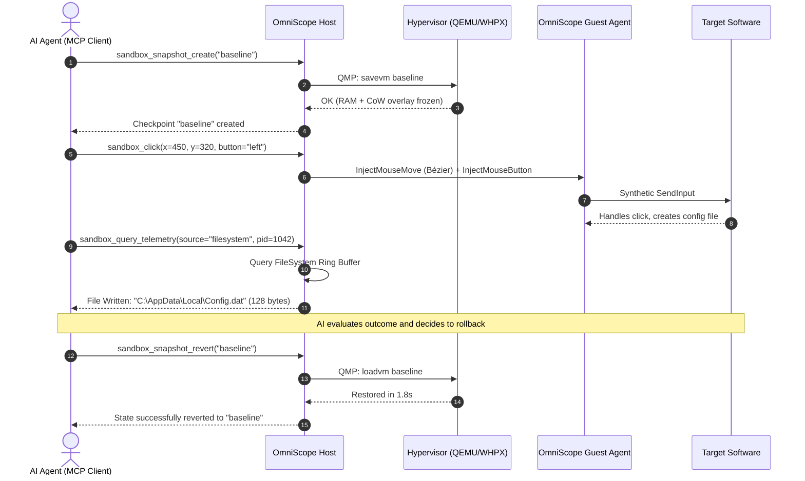
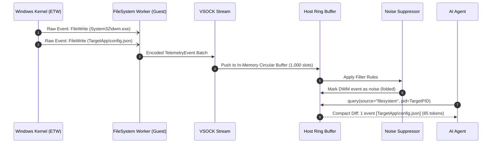
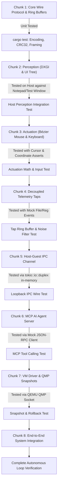

# SDLC Phase 2: System Architecture & Detailed Design

**Project Name:** OmniScope (AI-Orchestrated Dynamic Software Introspection & Interaction Sandbox)  
**Target Platform:** Windows Host & Guest (Modular for Linux/KVM)  
**Primary Language:** Rust (`stable-x86_64-pc-windows-msvc`)  
**Document Version:** 1.0.0  
**Status:** Approved for Implementation (SDLC Phase 2)

---

## 1. System Decomposition & Crate Topology

OmniScope is structured as a unified Cargo workspace partitioned into three decoupled crates:

```
e:\Sandbox_project\
├── Cargo.toml                          # Workspace manifest
├── docs\
│   ├── 01_PLANNING_AND_FEASIBILITY.md   # Phase 1: Charter & Requirements
│   └── 02_ARCHITECTURE_AND_DETAILED_DESIGN.md # Phase 2: Architecture & Specs
└── crates\
    ├── omniscope-core\                 # Shared Data Models & Wire Protocol
    │   ├── Cargo.toml
    │   └── src\
    │       ├── lib.rs
    │       ├── protocol.rs             # IPC framing, serialization & packet enums
    │       ├── events.rs               # Telemetry schemas (FS, Reg, Net, Proc, UI)
    │       ├── commands.rs             # Actuation & perception command definitions
    │       ├── error.rs                # Unified error handling & result types
    │       └── ring_buffer.rs          # Generic lock-free circular ring buffer
    │
    ├── omniscope-guest\                # In-Guest Agent (Perception, Actuation, Telemetry)
    │   ├── Cargo.toml
    │   └── src\
    │       ├── main.rs                 # Guest daemon entrypoint
    │       ├── ipc_client.rs           # VSOCK / virtio-serial connection handler
    │       ├── perception\
    │       │   ├── dxgi_capture.rs     # Low-latency desktop duplication capture
    │       │   └── uia_tree.rs         # Windows UI Automation accessibility walker
    │       ├── actuation\
    │       │   ├── bezier_mouse.rs     # Human-cadence Bézier curve mouse driver
    │       │   ├── keyboard.rs         # SendInput synthetic typing with jitter
    │       │   └── process_runner.rs   # Target process launcher & lifecycle
    │       └── telemetry\
    │           ├── etw_manager.rs      # Kernel ETW session controller
    │           ├── process_tap.rs      # Process, thread, and DLL load worker
    │           ├── filesystem_tap.rs   # File I/O & path modification worker
    │           ├── registry_tap.rs     # Registry key/value modification worker
    │           └── network_tap.rs      # Socket connections & DNS query worker
    │
    └── omniscope-host\                 # Host Control Plane & MCP Server
        ├── Cargo.toml
        └── src\
            ├── main.rs                 # Host daemon & CLI entrypoint
            ├── vm\
            │   ├── qemu_manager.rs     # QEMU process lifecycle & WHPX flags
            │   ├── qmp_client.rs       # QEMU Machine Protocol JSON-RPC driver
            │   └── snapshot_mgr.rs     # RAM & CoW disk overlay checkpointing
            ├── ipc_server.rs           # Host-side VSOCK / virtio-serial listener
            ├── telemetry\
            │   ├── aggregator.rs       # Multi-worker ring buffer coordinator
            │   └── noise_filter.rs     # Background noise suppression & folding
            ├── fake_net\
            │   ├── dns_responder.rs    # Simulated DNS resolver (local sinkhole)
            │   └── http_mock.rs        # Synthetic HTTP/HTTPS/NTP responder
            └── mcp\
                ├── protocol.rs         # Model Context Protocol JSON-RPC types
                ├── server.rs           # MCP Server over stdio / HTTP
                └── tools.rs            # Tool implementations exposed to LLMs
```

---

## 2. Host-Guest IPC Wire Protocol Specification

Communication between `omniscope-host` and `omniscope-guest` operates over a paravirtualized stream channel (`virtio-serial` or `VSOCK`).

### 2.1 Binary Packet Framing
Every message across the boundary is wrapped in an immutable 22-byte header followed by a variable-length Bincode payload and a 32-bit CRC checksum:

```
 0                   1                   2                   3
 0 1 2 3 4 5 6 7 8 9 0 1 2 3 4 5 6 7 8 9 0 1 2 3 4 5 6 7 8 9 0 1
+-+-+-+-+-+-+-+-+-+-+-+-+-+-+-+-+-+-+-+-+-+-+-+-+-+-+-+-+-+-+-+-+
|                       Magic: 0x4F4D4E49 ('OMNI')              |
+-+-+-+-+-+-+-+-+-+-+-+-+-+-+-+-+-+-+-+-+-+-+-+-+-+-+-+-+-+-+-+-+
|  Version (1B) |   Flags (1B)  |           Reserved (2B)       |
+-+-+-+-+-+-+-+-+-+-+-+-+-+-+-+-+-+-+-+-+-+-+-+-+-+-+-+-+-+-+-+-+
|                      Sequence ID (64-bit)                     |
|                                                               |
+-+-+-+-+-+-+-+-+-+-+-+-+-+-+-+-+-+-+-+-+-+-+-+-+-+-+-+-+-+-+-+-+
|                      Payload Length (32-bit)                  |
+-+-+-+-+-+-+-+-+-+-+-+-+-+-+-+-+-+-+-+-+-+-+-+-+-+-+-+-+-+-+-+-+
|                      Payload Bytes (Variable)                 |
|                               ...                             |
+-+-+-+-+-+-+-+-+-+-+-+-+-+-+-+-+-+-+-+-+-+-+-+-+-+-+-+-+-+-+-+-+
|                       CRC-32 Checksum (32-bit)                |
+-+-+-+-+-+-+-+-+-+-+-+-+-+-+-+-+-+-+-+-+-+-+-+-+-+-+-+-+-+-+-+-+
```

* **Magic (4 Bytes):** Fixed ASCII `0x4F4D4E49` (`OMNI`).
* **Version (1 Byte):** Protocol version (currently `0x01`).
* **Flags (1 Byte):**
  * `0x01`: Compressed payload (Zstandard).
  * `0x02`: Urgent message (high priority).
  * `0x04`: Error response.
* **Sequence ID (8 Bytes):** Monotonically increasing `u64` request/response correlator.
* **Payload Length (4 Bytes):** Little-endian `u32` byte count of the serialized payload.
* **CRC-32 (4 Bytes):** IEEE 802.3 CRC over payload bytes to guarantee data integrity.

### 2.2 Host Command Schema (`GuestCommand`)

```rust
#[derive(Debug, Serialize, Deserialize)]
pub enum GuestCommand {
    /// Ping/Keepalive
    Ping { timestamp_ms: u64 },

    /// Target Process Control
    LaunchProcess {
        executable_path: String,
        arguments: Vec<String>,
        working_dir: Option<String>,
        suspend_on_entry: bool,
    },
    TerminateProcess { pid: u32 },

    /// Perception
    CaptureScreen {
        format: ImageFormat, // Png, Jpeg, WebP
        quality: u8,         // 1-100
        crop_active_window: bool,
    },
    GetAccessibilityTree {
        max_depth: u32,
        root_hwnd: Option<u64>,
    },

    /// Physical Actuation
    InjectMouseMove {
        target_x: i32,
        target_y: i32,
        duration_ms: u32,
        use_bezier_curve: bool,
    },
    InjectMouseButton {
        button: MouseButton, // Left, Right, Middle
        action: ButtonAction, // Down, Up, Click, DoubleClick
    },
    InjectKeyboard {
        text: String,
        press_enter: bool,
        inter_key_jitter_ms: (u32, u32), // e.g. (60, 150)
    },

    /// Telemetry Taps Management
    ConfigureTaps {
        target_pids: Vec<u32>,
        enable_process: bool,
        enable_filesystem: bool,
        enable_registry: bool,
        enable_network: bool,
    },
    QueryTelemetrySlice {
        source: TelemetrySource,
        pid_filter: Option<u32>,
        string_filter: Option<String>,
        limit: u32,
    },

    /// Micro-Introspection
    InspectProcessMemory {
        pid: u32,
        query: MemoryQueryType, // Strings, LoadedModules, OpenHandles
    },
}
```

### 2.3 Guest Response Schema (`GuestResponse`)

```rust
#[derive(Debug, Serialize, Deserialize)]
pub enum GuestResponse {
    Pong { timestamp_ms: u64 },
    ProcessLaunched { pid: u32, main_thread_id: u32 },
    ProcessTerminated { pid: u32, exit_code: i32 },
    ScreenFrame {
        width: u32,
        height: u32,
        format: ImageFormat,
        data: Vec<u8>,
    },
    AccessibilityTree {
        root: UiElementNode,
    },
    ActuationCompleted {
        success: bool,
    },
    TelemetrySlice {
        source: TelemetrySource,
        events: Vec<TelemetryEvent>,
        total_captured: u64,
        dropped_events: u64,
    },
    MemoryInspectionResult {
        pid: u32,
        details: MemoryDetails,
    },
    Error {
        code: ErrorCode,
        message: String,
    },
}
```

---

## 3. Telemetry Event Data Models

```rust
#[derive(Debug, Clone, Serialize, Deserialize)]
pub enum TelemetryEvent {
    Process(ProcessEvent),
    FileSystem(FileSystemEvent),
    Registry(RegistryEvent),
    Network(NetworkEvent),
}

#[derive(Debug, Clone, Serialize, Deserialize)]
pub struct ProcessEvent {
    pub timestamp_ns: u64,
    pub event_type: ProcessEventType, // Start, Exit, ThreadCreate, LoadDll
    pub pid: u32,
    pub parent_pid: Option<u32>,
    pub image_name: String,
    pub command_line: Option<String>,
    pub dll_path: Option<String>,
}

#[derive(Debug, Clone, Serialize, Deserialize)]
pub struct FileSystemEvent {
    pub timestamp_ns: u64,
    pub pid: u32,
    pub operation: FileOp, // Create, Read, Write, Delete, Rename
    pub file_path: String,
    pub bytes_transferred: Option<u64>,
}

#[derive(Debug, Clone, Serialize, Deserialize)]
pub struct RegistryEvent {
    pub timestamp_ns: u64,
    pub pid: u32,
    pub operation: RegistryOp, // OpenKey, CreateKey, SetValue, DeleteValue
    pub key_path: String,
    pub value_name: Option<String>,
    pub data_preview: Option<String>,
}

#[derive(Debug, Clone, Serialize, Deserialize)]
pub struct NetworkEvent {
    pub timestamp_ns: u64,
    pub pid: u32,
    pub protocol: NetProtocol, // Tcp, Udp, Dns
    pub local_addr: String,
    pub remote_addr: String,
    pub domain_query: Option<String>,
    pub bytes_sent: u64,
    pub bytes_recv: u64,
}

#[derive(Debug, Clone, Serialize, Deserialize)]
pub struct UiElementNode {
    pub id: String,
    pub control_type: String, // "Button", "Edit", "Window", "ListItem", "Menu"
    pub name: String,
    pub bounds: [i32; 4],     // [left, top, width, height]
    pub is_enabled: bool,
    pub is_focused: bool,
    pub children: Vec<UiElementNode>,
}
```

---

## 4. Model Context Protocol (MCP) Tool Declarations

The AI agent interacts with the sandbox exclusively through the standard Model Context Protocol. Below are the 10 core tools exposed:

```json
[
  {
    "name": "sandbox_status",
    "description": "Returns current sandbox state, hypervisor status, target process PID, and available snapshots.",
    "inputSchema": { "type": "object", "properties": {} }
  },
  {
    "name": "sandbox_snapshot_create",
    "description": "Takes an instantaneous RAM and CoW disk snapshot. Useful before taking exploratory actions.",
    "inputSchema": {
      "type": "object",
      "properties": {
        "snapshot_name": { "type": "string", "description": "Descriptive tag for the checkpoint" }
      },
      "required": ["snapshot_name"]
    }
  },
  {
    "name": "sandbox_snapshot_revert",
    "description": "Instantly rolls back the guest VM to a previously saved snapshot checkpoint.",
    "inputSchema": {
      "type": "object",
      "properties": {
        "snapshot_name": { "type": "string", "description": "Name of the checkpoint to restore" }
      },
      "required": ["snapshot_name"]
    }
  },
  {
    "name": "sandbox_launch_app",
    "description": "Launches a target application inside the sandbox with automated telemetry tracking.",
    "inputSchema": {
      "type": "object",
      "properties": {
        "executable_path": { "type": "string", "description": "Absolute path inside guest" },
        "arguments": { "type": "array", "items": { "type": "string" } },
        "suspend_on_entry": { "type": "boolean", "default": false }
      },
      "required": ["executable_path"]
    }
  },
  {
    "name": "sandbox_get_screen",
    "description": "Captures the current desktop screen buffer. Returns image and dimensions.",
    "inputSchema": {
      "type": "object",
      "properties": {
        "crop_active_window": { "type": "boolean", "default": false },
        "format": { "type": "string", "enum": ["webp", "jpeg", "png"], "default": "webp" }
      }
    }
  },
  {
    "name": "sandbox_get_ui_tree",
    "description": "Queries the Windows UI Automation tree to retrieve structured controls, labels, and bounding boxes.",
    "inputSchema": {
      "type": "object",
      "properties": {
        "window_filter": { "type": "string", "description": "Filter by window title regex" },
        "max_depth": { "type": "integer", "default": 5 }
      }
    }
  },
  {
    "name": "sandbox_click",
    "description": "Moves mouse cursor along a natural human Bézier trajectory and performs a click.",
    "inputSchema": {
      "type": "object",
      "properties": {
        "x": { "type": "integer" },
        "y": { "type": "integer" },
        "button": { "type": "string", "enum": ["left", "right", "middle"], "default": "left" },
        "click_type": { "type": "string", "enum": ["click", "double_click"], "default": "click" }
      },
      "required": ["x", "y"]
    }
  },
  {
    "name": "sandbox_type_text",
    "description": "Types text with realistic inter-keystroke timing jitter (60ms-150ms) to defeat anti-automation checks.",
    "inputSchema": {
      "type": "object",
      "properties": {
        "text": { "type": "string" },
        "press_enter": { "type": "boolean", "default": false }
      },
      "required": ["text"]
    }
  },
  {
    "name": "sandbox_query_telemetry",
    "description": "Queries the on-demand telemetry ring buffer for a specific subsystem. Returns a concise semantic diff (<100 tokens).",
    "inputSchema": {
      "type": "object",
      "properties": {
        "source": { "type": "string", "enum": ["process", "filesystem", "registry", "network"] },
        "pid": { "type": "integer", "description": "Target PID to filter" },
        "filter": { "type": "string", "description": "Sub-string filter on path, key, or domain" },
        "limit": { "type": "integer", "default": 20 }
      },
      "required": ["source"]
    }
  },
  {
    "name": "sandbox_inspect_memory",
    "description": "Performs micro-level process introspection (strings in heap/stack, loaded DLLs, active handles).",
    "inputSchema": {
      "type": "object",
      "properties": {
        "pid": { "type": "integer" },
        "query_type": { "type": "string", "enum": ["strings", "modules", "handles"] }
      },
      "required": ["pid", "query_type"]
    }
  }
]
```

---

## 5. Sequence & Control Flow Diagrams

### 5.1 AI Exploration & Deterministic Rollback Loop



### 5.2 Decoupled Telemetry Tap Ingestion & Query Flow



---

## 6. Implementation Dependencies

### Core Crate (`omniscope-core`)
* `serde` & `serde_json` (Derived serialization)
* `bincode` (Compact zero-copy binary wire encoding)
* `crc32fast` (High-speed hardware CRC calculation)
* `thiserror` (Idiomatic Rust error definitions)

### Guest Crate (`omniscope-guest`)
* `windows` (`windows-rs` version `0.58+` with features: `Win32_Graphics_Dxgi`, `Win32_UI_WindowsAndMessaging`, `Win32_UI_Accessibility`, `Win32_System_Diagnostics_Etw`, `Win32_System_Threading`)
* `tokio` (Async runtime with multi-threaded executor)
* `image` (Desktop duplication frame compression to PNG/WebP)
* `rand` (Bézier jitter and human keystroke delay randomization)

### Host Crate (`omniscope-host`)
* `tokio` (Full async runtime with networking and process management)
* `tokio-util` (Codec & framed stream handling)
* `qapi` / custom QMP client (Async QEMU Machine Protocol JSON-RPC)
* `tracing` & `tracing-subscriber` (Structured host diagnostics)

---

## 7. Modular Incremental Development & Testing Strategy (TDD & Build Plan)

To minimize complexity and prevent difficult cross-boundary debugging, development follows an **Incremental, Test-First Modular Workflow**. Each module is designed to be self-contained, unit-tested independently on the host, integrated with previously built chunks, and re-tested before advancing.



### Module Breakdown & Verification Strategy

| Chunk | Scope | How It Is Built & Tested in Isolation |
| :--- | :--- | :--- |
| **Chunk 1: Core Foundation** | Packet framing, Bincode serialization, CRC32 verification, circular ring buffers. | **100% Pure Unit Tests:** Verified instantly with `cargo test -p omniscope-core` (verifying corrupted CRC detection, ring buffer rollover, and zero-allocation framing). |
| **Chunk 2: Actuation Engine** | Cubic Bézier mouse interpolation, jitter algorithms, keyboard delay variance. | **Math & Dry-Run Tests:** Unit tests verify Bézier acceleration curves; dry-run mode validates coordinates without moving physical hardware. Live test moves cursor across designated coordinates. |
| **Chunk 3: Perception Engine** | DXGI desktop duplication frame capture, UI Automation tree walker. | **Direct Host Test:** Run locally on Windows host against standard desktop windows (e.g. `notepad.exe` or a test window) to verify frame extraction and control hierarchy serialization without needing a VM. |
| **Chunk 4: Telemetry Taps** | Decoupled worker pipelines (Process, Filesystem, Registry, Network) & noise filter. | **Targeted Event Tests:** Spawns a dummy process that creates a temp file and registry key; asserts the tap catches the events and stores them in the ring buffer. |
| **Chunk 5: IPC Channel** | Async framed stream reader/writer (`virtio-serial` / `VSOCK`). | **In-Memory Duplex Test:** Tested using `tokio::io::duplex` where Host and Guest instances run in the same process exchanging real binary packets over a virtual wire. |
| **Chunk 6: MCP AI Bridge** | Model Context Protocol JSON-RPC tool endpoints over stdio. | **Automated RPC Test:** Script sends JSON-RPC requests (`sandbox_query_telemetry`, `sandbox_click`) and asserts conforming JSON responses. |
| **Chunk 7: VM & Snapshots** | QEMU WHPX runner and QMP socket controller. | **QMP Integration Test:** Launches headless QEMU, creates a test snapshot `checkpoint1`, writes to disk, restores `checkpoint1`, and verifies disk revert. |
| **Chunk 8: End-to-End Integration** | Connecting all pieces into the complete OmniScope sandbox loop. | **End-to-End Test:** AI tool call $\rightarrow$ Host MCP $\rightarrow$ IPC $\rightarrow$ Guest $\rightarrow$ Target App $\rightarrow$ Telemetry $\rightarrow$ Rollback. |

