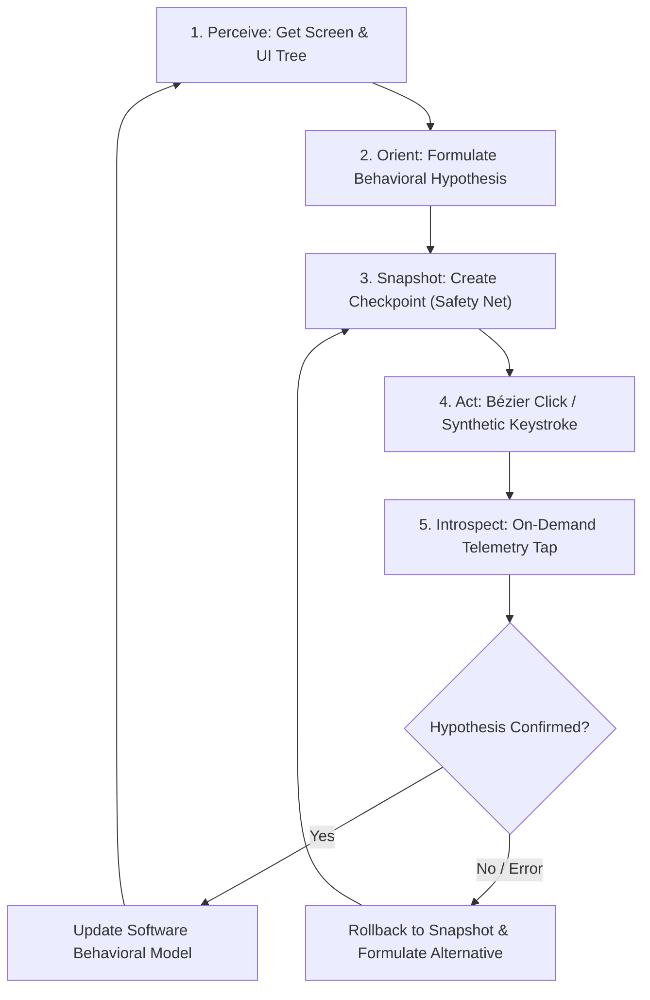

# SDLC Phase 2 Addendum: Chunk Deep-Dive, Inter-System Contracts, Observability & AI Playbook

**Project Name:** OmniScope (AI-Orchestrated Dynamic Software Introspection & Interaction Sandbox)  
**Target Platform:** Windows Host & Guest (Modular for Linux/KVM)  
**Primary Language:** Rust (`stable-x86_64-pc-windows-msvc`)  
**Document Version:** 1.0.0  
**Status:** Architectural Specification & Design Blueprint

---

## 1. Microscopic Chunk Specifications & Inter-System Contracts

This section defines the precise contract, responsibilities, input/output data structures, failure modes, and recovery mechanisms for each of the 8 modular chunks.

```
┌─────────────────────────────────────────────────────────────────────────────┐
│                          CROSS-SYSTEM CONTRACT MAP                          │
│                                                                             │
│  [Chunk 6: MCP Server] ◄──► [AI Agent Client (JSON-RPC)]                    │
│           │                                                                 │
│           ▼                                                                 │
│  [Chunk 7: VM & Snapshots] ◄── (QMP Socket) ──► [QEMU Hypervisor]          │
│           │                                                                 │
│           ▼                                                                 │
│  [Chunk 5: IPC Channel (VSOCK/Framed)]                                       │
│           ▲                                                                 │
│     (Wire Framing & Core Models: Chunk 1)                                   │
│           ▼                                                                 │
│  [Guest Orchestrator Daemon]                                                │
│      ├──► [Chunk 2: Actuation (Bézier Mouse / Jitter Keyboard)]             │
│      ├──► [Chunk 3: Perception (DXGI Capture / UI Tree)]                    │
│      └──► [Chunk 4: Decoupled Telemetry Taps (Process, FS, Reg, Net)]       │
│                                                                             │
│  All Chunks Feed ──► [Unified Diagnostics & Flight Recorder Engine]         │
└─────────────────────────────────────────────────────────────────────────────┘
```

---

### Chunk 1: Core Wire Protocol, Serialization & Circular Buffers (`omniscope-core`)
* **Role:** The foundational source of truth shared between host and guest.
* **Responsibilities:**
  - Standardized 22-byte binary frame packing/unpacking.
  - IEEE 802.3 hardware-accelerated CRC-32 calculation and verification.
  - Zero-copy Bincode serialization of commands, responses, and events.
  - Thread-safe, lock-free circular ring buffer implementation (`RingBuffer<T, N>`).
* **Key Contracts & Types:**
  ```rust
  pub struct FrameHeader {
      pub magic: [u8; 4],      // 0x4F4D4E49 ("OMNI")
      pub version: u8,         // 0x01
      pub flags: u8,           // Bit 0: Compressed, Bit 1: Urgent, Bit 2: Error
      pub reserved: u16,
      pub sequence_id: u64,    // Correlates request/response
      pub payload_len: u32,
      pub crc32: u32,          // Checksum of payload bytes
  }
  ```
* **Failure Modes & Defenses:**
  - *Data Corruption on Wire:* If CRC32 fails, frame is discarded, error counter incremented, and `FrameDecodeError::CrcMismatch` returned.
  - *Buffer Overflow:* Ring buffer uses atomic overwrite semantics (`push_overwrite`) so new events never block telemetry threads; dropped count is tracked.
* **Verification:** Unit tests verifying frame roundtrips, corrupted bytes, byte-stream fragmentation, and concurrent ring buffer writes.

---

### Chunk 2: Actuation Engine (Bézier Mouse & Keyboard) (`omniscope-guest`)
* **Role:** Translates AI action intentions into synthetic OS input that mimics human biometrics.
* **Responsibilities:**
  - Generate cubic Bézier curves between current mouse position $(x_0, y_0)$ and target $(x_1, y_1)$ with random control points and ease-in/ease-out acceleration.
  - Inject mouse clicks and keyboard events via Windows `SendInput`.
  - Apply Gaussian timing jitter to keypresses (e.g. 70ms–140ms delay between down and up) to bypass anti-automation / anti-bot detection.
* **Key Functions:**
  ```rust
  pub struct BezierTrajectory {
      pub points: Vec<(i32, i32, std::time::Duration)>,
  }
  pub fn generate_bezier_path(start: (i32, i32), target: (i32, i32), speed_factor: f32) -> BezierTrajectory;
  pub fn execute_trajectory(trajectory: &BezierTrajectory) -> Result<(), ActuationError>;
  pub fn synthesize_keystrokes(text: &str, jitter_range_ms: (u32, u32)) -> Result<(), ActuationError>;
  ```
* **Failure Modes & Defenses:**
  - *Out of Bounds Coordinates:* Clamps target $(x, y)$ strictly within primary display resolution bounds (`GetSystemMetrics`).
  - *Input Blocked by UAC / Higher Integrity Window:* Guest service runs at `SYSTEM` or elevated integrity with `uiAccess=true` attribute in manifest.
* **Verification:** Unit tests for Bézier mathematical interpolation; dry-run coordinate verification; live cursor trace tests.

---

### Chunk 3: Perception Engine (DXGI Vision & UI Automation Tree) (`omniscope-guest`)
* **Role:** Provides multimodal visual and semantic accessibility perception of the guest OS.
* **Responsibilities:**
  - Zero-copy desktop frame grabbing via DirectX Graphics Infrastructure (`IDXGIOutputDuplication`).
  - Compress raw RGBA surface into WebP/PNG byte buffers for AI vision consumption.
  - Recursively parse the Windows UI Automation tree (`IUIAutomation`) to extract window handles, control roles (Button, ComboBox, Edit), accessibility names, bounding rectangles, and enablement state.
* **Key Functions:**
  ```rust
  pub fn capture_desktop_frame(format: ImageFormat, quality: u8) -> Result<RawFrame, PerceptionError>;
  pub fn walk_ui_tree(root_window: Option<HWND>, max_depth: usize) -> Result<UiElementNode, PerceptionError>;
  ```
* **Failure Modes & Defenses:**
  - *DXGI Access Lost (Display Mode Switch / Screen Lock):* Catch `DXGI_ERROR_ACCESS_LOST`, release old duplication context, and recreate duplication interface automatically.
  - *Deep / Recursive UI Tree Hang:* Cap recursive depth (`max_depth: 6`) and implement a 2-second timeout on COM interface queries.
* **Verification:** Direct execution on host against standard Windows apps (`notepad.exe`, `calc.exe`), asserting valid frames and extracted UI hierarchy.

---

### Chunk 4: Decoupled Telemetry Taps & Noise Filter (`omniscope-guest` & `omniscope-host`)
* **Role:** Collects operating system events without overloading LLM context windows.
* **Responsibilities:**
  - Spawn 4 independent worker threads:
    1. **Process Tap:** Kernel ETW tracing for process birth/death, thread creation, DLL module loading.
    2. **FileSystem Tap:** File creation, writes, reads, deletions, renames.
    3. **Registry Tap:** Key/value creation, modification, deletion.
    4. **Network Tap:** TCP connects, UDP packets, DNS queries.
  - Stream events to local ring buffers; push filtered slices to the host over IPC.
  - Host-side noise suppression folds background OS noise (`dwm.exe`, `SearchApp.exe`, `explorer.exe` tile polling).
* **Failure Modes & Defenses:**
  - *ETW Buffer Flooding:* Configure ETW session with adequate kernel buffers (`BufferSize=64KB`, `MaxBuffers=128`); if events drop, record `dropped_events` count.
  - *Worker Thread Panic:* Each tap runs inside a supervised `tokio` task or thread with a catch-unwind wrapper, logging the error and automatically restarting.
* **Verification:** Integration test running against a test binary that writes a file, reads registry, and spawns a thread, asserting the ring buffer stores exact event records.

---

### Chunk 5: Host-Guest IPC Channel (`omniscope-host` & `omniscope-guest`)
* **Role:** High-speed, memory-safe, paravirtualized communications bridge.
* **Responsibilities:**
  - Connect Host Orchestrator to Guest Agent via `virtio-serial` or `VSOCK` port `0x5000`.
  - Implement `tokio_util::codec::Framed` over the stream using the Chunk 1 framing protocol.
  - Provide asynchronous RPC calling (`send_command(cmd) -> Result<GuestResponse>`) with correlated sequence IDs.
* **Failure Modes & Defenses:**
  - *Connection Drop / VM Reboot:* Automatic exponential backoff reconnection on host; requests pending on dropped connection return `IpcError::ConnectionReset`.
  - *Stale / Desynchronized Stream:* Magic byte scanner resynchronizes the parser if garbage bytes are encountered.
* **Verification:** Loopback integration test using `tokio::io::duplex` exchanging commands and responses concurrently.

---

### Chunk 6: Model Context Protocol (MCP) AI Server (`omniscope-host`)
* **Role:** Exposes high-level tools to the AI agent over JSON-RPC 2.0 (stdio / HTTP).
* **Responsibilities:**
  - Implement the official Model Context Protocol (MCP) specification.
  - Serve tool schemas (`sandbox_launch_app`, `sandbox_click`, `sandbox_query_telemetry`, etc.).
  - Translate AI tool invocations into host orchestration and IPC calls.
  - Format output payloads into compact, token-efficient Markdown / JSON strings.
* **Failure Modes & Defenses:**
  - *Malformed Tool Arguments:* Strict JSON schema validation; returns descriptive error messages with expected fields rather than crashing.
  - *Tool Timeout:* Enforce 10-second deadline per tool invocation to keep the AI agent responsive.
* **Verification:** Automated JSON-RPC test script invoking every tool definition and checking response schemas.

---

### Chunk 7: Hypervisor Orchestrator & Snapshots (`omniscope-host`)
* **Role:** Manages QEMU/WHPX VM lifecycle, cloaking, and state checkpoints.
* **Responsibilities:**
  - Launch QEMU with hardened stealth parameters (`-cpu host,kvm=off`, realistic ACPI, masked hypervisor flags).
  - Connect to QEMU Machine Protocol (QMP) UNIX/TCP socket.
  - Execute instantaneous snapshots (`savevm <tag>`, `loadvm <tag>`).
* **Failure Modes & Defenses:**
  - *QEMU Hang on Snapshot:* Set 5-second socket timeout on QMP commands; emit diagnostic alert if snapshot takes >3s.
  - *WHPX Initialization Failure:* Detect missing hypervisor features early and emit clear configuration instructions.
* **Verification:** Script launches headless QEMU, writes a file inside guest, takes snapshot, modifies file, reverts snapshot, and verifies file reverted.

---

### Chunk 8: Full End-to-End System Integration
* **Role:** Connects the entire stack into a seamless, autonomous software analysis loop.
* **Responsibilities:**
  - Orchestrates the full lifecycle: Boot VM $\rightarrow$ Handshake Guest Agent $\rightarrow$ Expose MCP Server $\rightarrow$ AI Agent Connects $\rightarrow$ Target Execution $\rightarrow$ Dissection $\rightarrow$ Clean Teardown.
* **Verification:** Run a complete test session where an autonomous agent analyzes a dummy Windows application, maps its buttons, detects which registry key it writes, and rolls back cleanly.

---

## 2. Cross-Chunk Failure Scenarios & Self-Healing Matrix

| Failure Scenario | Affected Chunks | Root Cause | Self-Healing / Defense Mechanism |
| :--- | :--- | :--- | :--- |
| **Guest Agent Crashes During Binary Execution** | Chunk 4, 5, 6 | Target binary crashed system or exhausted resources. | Host IPC detects broken pipe. Host issues QMP `loadvm` to rollback to last stable checkpoint in <2s and reconnects IPC automatically. |
| **AI Injects Click on Hidden / Occluded Button** | Chunk 2, 3, 6 | UI changed unexpectedly or window lost focus. | Chunk 3 UI walker detects target coordinate is not in frontmost Z-order; returns `ActuationError::TargetOccluded(details)` so AI can re-evaluate. |
| **ETW Telemetry Buffer Flooded** | Chunk 4, 1 | Target app performs 50,000 rapid file operations. | Ring buffer drops oldest entries, increments `dropped_count`, and sets `Flag::Overflow`. AI query receives summary: *"50,000 events truncated; last 1,000 shown"*. |
| **Target App Detects Hypervisor and Exits** | Chunk 7, 4 | Target uses sophisticated timing / CPUID check. | Process tap logs unexpected exit code. QEMU stealth profile is adjusted (TSC virtualization offset) and session restarted. |

---

## 3. Unified Diagnostics, Telemetry Correlators & Flight Recorder

To guarantee that any post-deployment bug can be diagnosed immediately without guessing:

```
┌─────────────────────────────────────────────────────────────────────────────┐
│                      STRUCTURED FLIGHT RECORDER PIPELINE                     │
│                                                                             │
│  [Host Tracing Spans]   ──┐                                                 │
│  [Guest Tracing Spans]  ──┼──► [Correlation Engine: trace_id = 0x8A4F...]   │
│  [IPC Wire Payloads]    ──┤            │                                    │
│  [Kernel ETW Events]    ──┘            ▼                                    │
│                              ┌──────────────────────┐                       │
│                              │ In-Memory Ring Trace │ (Last 10,000 Spans)   │
│                              └──────────┬───────────┘                       │
│                                         │ On Crash or Anomaly               │
│                                         ▼                                   │
│                              ┌──────────────────────┐                       │
│                              │   crash_dump.json    │ (Complete execution   │
│                              │   + flight_log.jsonl │  timeline replay)     │
│                              └──────────────────────┘                       │
└─────────────────────────────────────────────────────────────────────────────┘
```

### 3.1 Trace Correlation (`trace_id`)
* Every AI action or tool call generates a 64-bit `trace_id`.
* The `trace_id` is stamped in the IPC `FrameHeader` and propagated into:
  - Host execution spans (`tracing::info_span!("mcp_tool", trace_id = %tid)`).
  - Guest actuation logs (`tracing::info_span!("inject_click", trace_id = %tid)`).
  - ETW kernel events captured during that action's execution window.
* **Benefit:** If an action fails, searching `trace_id` produces the complete, unified timeline across AI prompt, Host, Guest, and Kernel.

### 3.2 In-Memory Flight Recorder (Crash Dumps)
* Both Host and Guest maintain a 10MB memory-mapped circular log of all recent debug traces.
* In the event of an unhandled panic, fatal IPC disconnect, or hypervisor timeout, a custom panic hook flushes:
  1. The last 10,000 log lines to `logs/flight_recorder_<timestamp>.jsonl`.
  2. The active guest screen buffer as `logs/crash_screen.webp`.
  3. The active process list and memory stats.

---

## 4. The "Skills" Extensibility Framework (Software Dismantling Playbooks)

Beyond raw primitive tools (`sandbox_click`, `sandbox_type_text`), an AI agent dismantling software needs **higher-order cognitive strategies**. We introduce the **OmniScope Skill Layer**.

```
┌─────────────────────────────────────────────────────────────────────────────┐
│                              OMNISCOPE SKILL LAYER                          │
│                                                                             │
│  ┌───────────────────────────────────────────────────────────────────────┐  │
│  │ Higher-Order Skills (Composed Multi-Step Cognitive Strategies)        │  │
│  │ - skill_map_persistence()       - skill_trace_network_protocol()      │  │
│  │ - skill_differential_action()   - skill_fuzz_ui_inputs()              │  │
│  └───────────────────────────────────┬───────────────────────────────────┘  │
│                                      │ Composes                             │
│  ┌───────────────────────────────────▼───────────────────────────────────┐  │
│  │ Primitive Sandbox Tools (MCP Core)                                    │  │
│  │ - sandbox_click      - sandbox_query_telemetry   - sandbox_snapshot     │  │
│  │ - sandbox_get_screen - sandbox_get_ui_tree       - sandbox_inspect_mem  │  │
│  └───────────────────────────────────────────────────────────────────────┘  │
└─────────────────────────────────────────────────────────────────────────────┘
```

### 4.1 Core Skills Defined

#### Skill 1: `skill_map_persistence` (Configuration & Storage Discovery)
* **Goal:** Determine where and how a target software persists settings, licenses, or state.
* **Playbook Execution:**
  1. AI takes snapshot `clean_state`.
  2. Launches target app, opens settings window, toggles a configuration option, and clicks "Save".
  3. Skill queries the **FileSystem Tap** for non-temporary writes and **Registry Tap** for keys modified under `HKCU\Software`.
  4. Formulates a synthesized report: *"Target persists config in `%APPDATA%\TargetApp\config.json` and registry key `HKCU\Software\TargetApp\Settings`"*.

#### Skill 2: `skill_differential_action` (State-Delta Isolation)
* **Goal:** Determine the precise internal effect of a specific button or menu item.
* **Playbook Execution:**
  1. Snapshot $S_0$.
  2. Perform target action $A$ (e.g. click "Connect").
  3. Collect telemetry $\Delta_A$ (network sockets opened, threads created, DLLs loaded).
  4. Rollback to $S_0$.
  5. Perform control action $B$ (e.g. click "Cancel").
  6. Compute delta difference $\Delta_A \setminus \Delta_B$.
  7. Returns exact unique effects triggered exclusively by Action $A$.

#### Skill 3: `skill_trace_network_protocol` (Network API & Telemetry Mapping)
* **Goal:** Identify backend endpoints, request payloads, and encryption routines.
* **Playbook Execution:**
  1. Arms FakeNet DNS & HTTP proxy.
  2. Triggers target network action.
  3. Correlates outgoing socket connection with DNS resolution and internal process thread.
  4. Inspects memory heap around the socket send buffer to recover plaintext payloads before TLS encryption.

---

## 5. How an AI Actually Uses OmniScope: The Cognitive Loop

To enable an AI model (like Claude 3.5/3.7, GPT-4o, or an open-source agent) to understand and operate OmniScope effectively, the interaction is structured around a **Formal Cognitive Loop**.



### 5.1 The AI System Prompt & Mental Model
When an AI connects to OmniScope via MCP, it receives a foundational prompt defining its environment, capabilities, and ground rules:

```markdown
You are operating OmniScope, an isolated dynamic software analysis sandbox.
You have two hands and two eyes in this environment:
1. Physical Perception: You can see the screen (`sandbox_get_screen`) and read the structured accessibility tree (`sandbox_get_ui_tree`).
2. Physical Action: You can click (`sandbox_click`) and type (`sandbox_type_text`).
3. System Telescopes: You have on-demand telemetry taps to inspect process activity, file I/O, registry modifications, and network sockets (`sandbox_query_telemetry`).
4. Time Travel: You can freeze time (`sandbox_snapshot_create`) and rewind (`sandbox_snapshot_revert`).

Operational Rules:
- Always take a snapshot before triggering unfamiliar buttons or file operations.
- Do not poll raw telemetry. Formulate a specific hypothesis (e.g. "I suspect this button modifies a registry key"), perform the action, and query the specific tap (`registry`).
- If an application crashes or becomes unresponsive, instantly call `sandbox_snapshot_revert`.
```

### 5.2 Connecting an AI Agent in Practice

#### Method A: Direct Integration with AI IDEs / Claude Desktop (via MCP)
Add OmniScope to your `mcp_config.json`:
```json
{
  "mcpServers": {
    "omniscope": {
      "command": "e:\\Sandbox_project\\target\\release\\omniscope-host.exe",
      "args": ["--mcp-stdio"]
    }
  }
}
```
* The IDE / Claude immediately discovers all 10 tools and skills. The user can type:
  > *"Launch `TargetSoftware.exe`, explore its settings dialog, and tell me where it stores its license keys."*
* The AI autonomously calls `sandbox_launch_app`, checks the UI tree, clicks the Settings button, queries the file tap, and answers accurately.

#### Method B: Standalone Autonomous Agent Loop (CLI Runner)
A lightweight Rust or Python runner drives the agent continuously:
```rust
// Autonomous loop:
loop {
    let screen = host.get_screen().await?;
    let ui_tree = host.get_ui_tree().await?;
    let decision = llm_client.decide_next_step(&screen, &ui_tree, &current_goal).await?;
    match decision {
        Action::Interact { x, y } => host.click(x, y).await?,
        Action::QueryTap { source } => host.query_telemetry(source).await?,
        Action::GoalAchieved { report } => { println!("{}", report); break; }
    }
}
```

---

## 6. Implementation Readiness Summary

With this addendum:
1. Every chunk has an exact technical contract, input/output structures, and failure defenses.
2. Cross-system tracing and in-memory flight recorders guarantee that failures can be debugged with zero guesswork.
3. The future "Skills" framework provides a clear path for high-level software dismantling playbooks.
4. The AI cognitive loop and MCP connection patterns are rigorously defined.
